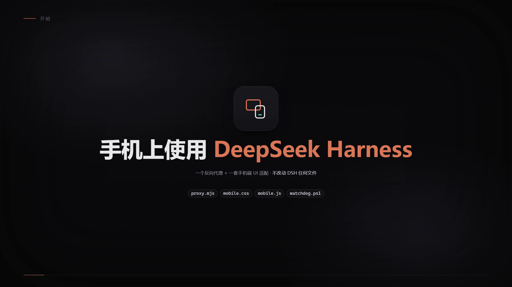

# dsh-phone-access

> 让手机上也能用 DeepSeek Harness：一个反向代理 + 一套手机端 UI 适配层，**不改动 DSH 任何文件**。

---

## 演示视频（45 秒）

[](assets/demo-16x9.mp4)

| 文件 | 规格 | 说明 |
|---|---|---|
| [`assets/demo-16x9.mp4`](assets/demo-16x9.mp4) | 1920×1080 · 30fps · 45s · H.264 + AAC | 横屏正片，带配乐，4.1 MB |
| [`assets/demo-9x16.mp4`](assets/demo-9x16.mp4) | 1080×1920 · 30fps · 45s | **竖屏版**，同一份场景描述，3.7 MB |
| [`assets/demo.srt`](assets/demo.srt) / [`.vtt`](assets/demo.vtt) | 24 条 | 外挂字幕（从场景描述自动抽出） |
| [`assets/contact-16x9.png`](assets/contact-16x9.png) | 4×3 拼图 | 每 5 秒一帧，一眼看完整体节奏 |

片子讲了六件事：**403 信任栅栏 → 网关头部重写 → 三种入口（LAN / 隧道 / Tailscale）→ 手机端 UI 适配 → 踩过的三个坑 → 守护自愈与开源发布**。

画面不是录屏，而是**逐帧由时间轴函数 `seek(t)` 算出来的**（任意时刻的画面由该时刻唯一决定，导出稳定可复现）。

### 怎么做的：一份场景描述，一条命令

```bash
node video-engine/build.mjs --spec video-engine/scenes/dsh-phone-access.json \
     --aspect 16:9 --aspect 9:16 --burn-subs
```

这条命令会依次做完并各自质检：

| 步骤 | 输入 | 产物 | 自检 |
|---|---|---|---|
| 配乐 | `spec.audio`（和弦段 + 51 个音效事件） | `-audio.wav` | 响度/真峰/频段/空洞/侧链 **7 项** |
| 字幕 | spec 里的文字元素 | `.srt` / `.vtt` | 24 条 |
| 渲染 | `spec.sections` | 两个画幅的无声片 | 1350 帧/画幅 |
| 混流 | 画面 + 配乐 | `-16x9.mp4` / `-9x16.mp4` | — |
| 质检 | 成片 | 报告 + 接触表 | **6 项** |

**"画声同源"是这套流水线的核心约束**：和弦进行与音效事件表就写在场景 JSON 里，和画面同一份数据——改画面节奏时音频不会掉队。

实测性能：双画幅并行渲染 **6.0 分钟**（串行 8.9 分钟）；瓶颈是逐帧渲染。

画面与声音的质检都是数字化的，不靠人耳人眼：

```
配乐  [PASS] 响度 -14.0 LUFS · 真峰 -2.0 dBTP · 低频 39.3% · 中频 10.5% · 空气 9.0% · 无空洞 · 侧链 -5.5dB
成片  [PASS] 分辨率 · 时长 · 30fps · 无黑场 · 接触表 · 混音 -14.3 LUFS
```

生成脚本全部开源在本仓库 `video-engine/` 下（`build.mjs` / `render.mjs` / `lib.mjs` 组件库 / `make-audio.py` / `qa.mjs` / `subs.mjs` / `compare.mjs`），没有第三方素材：配乐是纯程序合成的。

---

## 工作原理

```
手机 ──HTTP/HTTPS──> 局域网 / Cloudflare 隧道 / Tailscale
                        │
                        v
                  网关 proxy.mjs (:8080)
                   ├─ 重写 Host/Origin/Referer -> 127.0.0.1:<harness 端口>
                   ├─ 访问密钥闸门（?k=<key> -> 长期 Cookie）
                   ├─ 自己持有 Harness 的签名 Cookie 并注入上游（手机侧不用存）
                   ├─ gzip/br 解压后再改 HTML
                   ├─ 静态资源 immutable 缓存
                   └─ 移动端 UA 时注入 mobile.css + mobile.js
                        │
                        v
              Harness Web (127.0.0.1:43129)
```

实测对照（未做头部重写时）：

| 请求 | 结果 |
|---|---|
| `GET /`（非 loopback Host） | 200（栅栏不管首页） |
| `POST /api/session/list`（非 loopback Host/Origin） | **403** |
| 同上，经网关重写 | **200** |
| `WS /api/remote.mux`，经网关 | **101 Switching Protocols** |

## 快速开始

要求：Windows + DSH Desktop 正在运行 + Node（DSH 自带的 Electron 当 Node 用即可，见 `.desktop-bin\node.cmd`）。

### 1. 同一 Wi-Fi

```powershell
.\start-hidden.vbs      # 无窗口常驻；调试用 .\start.cmd 看日志
```

手机打开 `http://<电脑局域网IP>:8080/`。

### 2. 手机流量 / 任何网络（免费公网隧道）

```powershell
powershell -ExecutionPolicy Bypass -File .\start-public.ps1
```

首次会自动下载 `cloudflared`，然后打印并生成一个带密钥的 HTTPS 链接 + 二维码。**注意：Cloudflare 快速隧道的域名每次重启都会变**，换地址就重跑一次。

### 3. 固定地址（推荐）：Tailscale

Tailscale 免费且地址永久不变，还不把 DSH 暴露到公网：

1. 电脑装 [Tailscale](https://tailscale.com/download) 并登录，设备名例如 `my-pc`（登录后在管理台可见）
2. 手机装 Tailscale App，登录**同一账号**
3. 手机打开 `http://<你的设备名>:8080/?k=<你的密钥>`

网关会监听本机所有 IPv4（loopback + 局域网 + Tailscale 的 `100.x`），所以 Tailscale 一登录就能用；守护脚本会在网卡地址变化时自动重启网关补绑。

## 手机端 UI 适配

网关只在**移动端 UA**下注入 `mobile.css` + `mobile.js`（桌面端与 Electron 窗口实测零影响：响应 40385 字节、无注入）。

**布局**

- 左栏收窄到 48px，图标按钮补足 44px 触控高度
- **侧栏展开改成覆盖式抽屉**（原布局会把正文挤成 110px，现在正文保持满宽 342px）
- 右侧栏同理，展开时覆盖而不挤压
- 工作区/模式/PPT/Word/Excel 那一排改成横向滑动，不再被裁掉
- 输入框字号 ≥16px（避免 iOS 聚焦放大整页）；输入区与底部状态条算进 `safe-area-inset-bottom`
- 消息区、代码块、表格、图片、弹窗按窄屏适配（表格横滑、图片不溢出、弹窗限高可滚）
- 注入 `viewport-fit=cover`、`theme-color`、`interactive-widget=resizes-content`（软键盘弹出时正确压缩布局）
- PWA manifest 的 `fullscreen` 改成 `standalone`

**交互（`mobile.js`）**

- 抽屉打开时铺遮罩，**点遮罩即收起**
- **点会话行/导航行后自动收起抽屉**，腾出整屏看内容
- 兜底：监听「选中会话」变化也会收起；抽屉打开期间锁背景滚动

样式与交互都**按 mtime 热加载**，改完保存即生效，不用重启网关。

## 守护与自启

```powershell
.\install-watchdog.cmd      # 注册计划任务：每 5 分钟检查网关与隧道，掉了自动拉起
```

守护脚本同时负责：本机网卡地址变化后重启网关（补绑 Tailscale 网段）、把最新访问地址写到桌面的 `DSH-手机访问地址.txt`。

## 用 CDP 在电脑上回归手机端 UI

`tools/` 下是自用的验证工具：用本机 Edge 无头 + CDP 真实鼠标事件跑一段流程，截图并抓 DOM/网络/控制台。

```powershell
# 先复制 tools\flow.example.json 成 flow-final.json，把 URL 换成你自己的
& "$env:APPDATA\dsh-desktop\harness\.desktop-bin\node.cmd" tools\cdp-run.mjs tools\flow-final.json
```

实测结果（390×844 dpr2）：图标栏 49px / 正文 342px；抽屉 335px + 遮罩生效；点会话后 `data-sidebar-collapsed=true`、遮罩消失；全过程无控制台错误。

## 排障

| 现象 | 原因 / 处理 |
|---|---|
| 手机显示 530 / 隧道错误页 | cloudflared 挂了。重跑 `start-public.ps1`（地址会换新），或等守护任务拉起 |
| `401 缺少访问密钥` | 用了不带 `?k=` 的地址 |
| 页面是乱码 / 二进制 | 上游 gzip 未解压就被改写 —— 必须解压后再动 HTML，见 `decodeText()` |
| 界面能开但插件加载失败（`HTML did not preload ...`） | `/plugins/??a,b,c` 批量 URL 被 `new URL()` 序列化破坏 —— 必须按字符串处理请求目标 |
| 界面能开但一直 403 | 网关没跑，或 Host 没被重写成 loopback |
| 局域网打不开 | 管理员运行 `allow-firewall.cmd` |
| Tailscale 很慢 / 卡加载 | 打洞失败会走境外中继（`tailscale status` 里显示 `relay "sfo"` 之类）。此时改用隧道或同一 Wi-Fi |

## 踩过的坑（给后来人）

1. **gzip**：上游会按 `Accept-Encoding` 回 gzip/br，必须在压缩字节解压后再做 HTML 注入，否则页面直接变乱码。
2. **`??` 批量 URL**：DSH 的客户端插件走 `/plugins/??a/client.js,b/client.js`，一旦把请求目标丢给 `new URL()` 再序列化，`??` 会被当成查询串重写，插件全部 404。
3. **`setTimeout` 不触发**：DSH 客户端里 `setTimeout` 的回调实测一次都不跑（interval 正常）。所以 `mobile.js` 全部用**事件 + MutationObserver**实现，不要改回定时器。
4. **重定向地狱**：不要让浏览器去处理「401 → 换 Cookie → 重定向回 /」这条链，手机上会 `ERR_TOO_MANY_REDIRECTS`。认证 Cookie 由网关自己持有并注入上游，手机侧只需一把访问密钥。

## 安全说明

- 访问密钥（`phone-key.txt`）等价于这台电脑的命令执行权限：**不要外发带 `?k=` 的链接**，泄露就改密钥后重启网关。
- 公网隧道是 Cloudflare 快速隧道：随机域名、无账号、每次重启变化；要固定地址+公网可用就买域名走命名隧道，或直接用 Tailscale（不暴露公网）。
- 密钥、日志、地址文件、下载的二进制都已写进 `.gitignore`，不要提交。

## License

MIT
